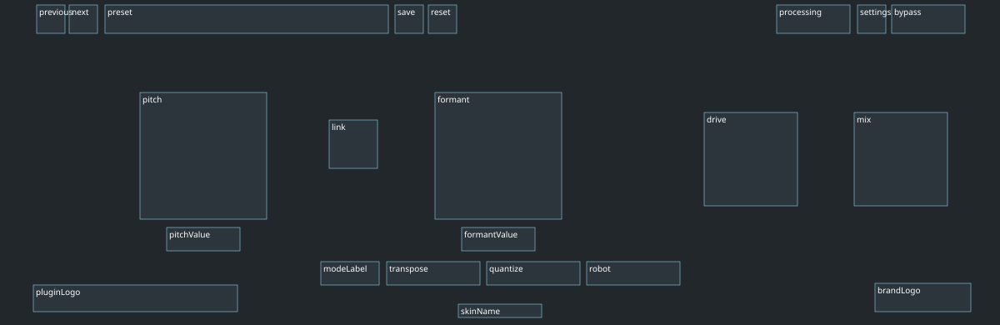
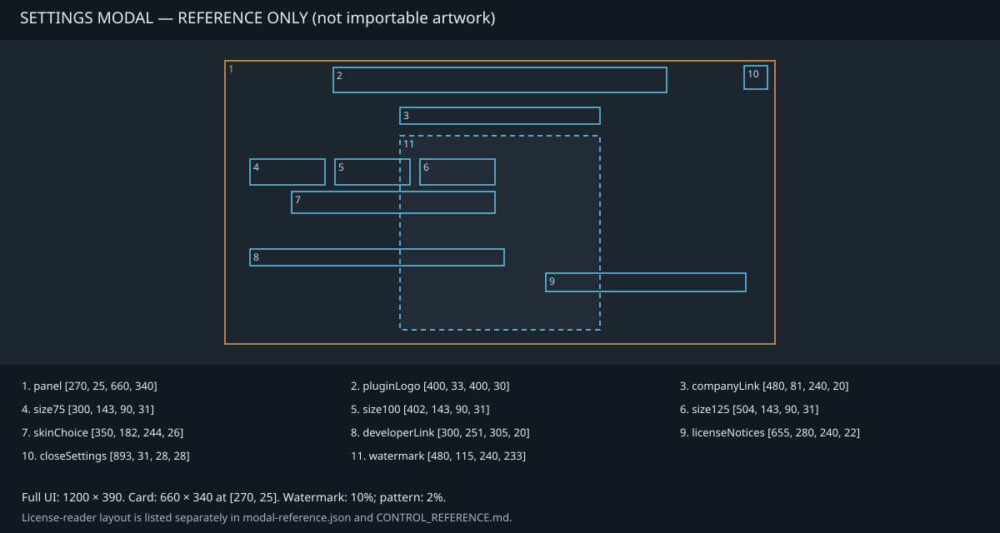

# BigAltedChico Skin Creator Guide

Design and share your own BigAltedChico skin using JSON and SVG. **You do not need C++, a compiler or a plugin rebuild.** This guide describes the current **schema 1** loader.

New to skins? Follow [QUICKSTART.md](QUICKSTART.md) first. The kit contains ready-to-import examples, editable artwork, a complete manifest and layout references.

## 1. Get the kit

Inside the plugin, open the settings gear, expand **Skin**, and select **Get skin template...**. The plugin exports a folder containing the embedded kit. You can also copy the repository's `SkinTemplate/` folder; it contains the latest documentation and examples. An older installed plugin may export an older copy of the kit.

Work on a duplicate. Use a plain-text editor for JSON and a vector editor that exports self-contained SVG and converts text to paths for artwork. Keep your design source files separately from the installable pack.

## 2. Start with a working recolour

Copy [recolour-example.json](recolour-example.json) to your own folder as `skin.json`:

```json
{
  "schemaVersion": 1,
  "id": "my-blue-skin",
  "name": "My Blue Skin",
  "extends": "salem",
  "colours": {
    "accent": "#60C8F2",
    "text": "#60C8F2"
  }
}
```

Choose a unique ID before importing. For example, use `yourname-blue` instead of the example's ID. The example needs only this JSON file: it inherits the remaining colours, artwork and rectangles from Salem.

Import it using **gear → Skin → Import skin...**. Select the JSON file, not the containing folder or a ZIP. On a successful import, the plugin installs and selects the skin.

[skin.json](skin.json) is the full Ondas-based example. [salem-example.json](salem-example.json) is another minimal Salem-based example. A custom skin must extend `ondas` or `salem`; the original Juguete renderer is not an available custom-skin base in schema 1.

## 3. Understand a pack

A full example has this flat structure:

```text
my-skin/
  skin.json
  background.svg
  plugin-logo.svg
  brand-logo.svg
  modal-logo.svg
  modal-background.svg
  README.md
  LICENSE
```

Only `skin.json` and the SVGs it references are needed to install the design. Your README and license are for recipients; the importer copies the manifest and referenced artwork into the installed folder.

| Manifest field | Required | Meaning |
| --- | --- | --- |
| `schemaVersion` | Yes | Keep `1`. |
| `id` | Yes | Stable identity, 1–64 characters: lowercase `a-z`, digits, `-`, `_`. |
| `name` | Yes | Display name, 1–48 characters. |
| `extends` | Yes | `ondas` or `salem`; chooses the built-in renderer and inherited defaults. |
| `colours` | No | Override any of the seven supported colour keys. |
| `controls` | No | Override rectangles for known control/branding IDs. |
| `background` | No | Main-interface SVG filename. |
| `pluginLogo` | No | BigAltedChico wordmark SVG filename. |
| `brandLogo` | No | Notficial LABS wordmark SVG filename. |
| `modalLogo` | No | Large settings watermark and repeating-pattern SVG filename. |
| `modalBackground` | No | Settings-card background SVG filename. |

Omit a field to inherit its default. To inherit artwork, remove the field completely; an empty string is invalid. `juguete`, `ondas` and `salem` are reserved IDs. Two skins can have the same display name, but their IDs must be different.

Keep the ID stable while editing or issuing an update of the same design: projects refer to it. Use a new ID for a separate design or variant.

## 4. Change colours

Colours use opaque six-digit hex values, for example `#60C8F2`. Short hex, alpha channels, named colours and CSS `rgb()` values are unsupported.

| Key | What it affects |
| --- | --- |
| `accent` | Active mode and LINK styling. |
| `ring` | Knob rims. |
| `pointer` | Knob indicators. |
| `label` | Main knob labels and scales. |
| `text` | Numeric readouts and LINK caption. |
| `muted` | Inactive mode text, MODE caption and skin name. |
| `button` | Inactive mode and LINK fills. |

The selected base renderer also affects widget appearance. These keys do not recolour every part of the interface: toolbar controls, active LIVE/BYPASS styling and parts of the settings UI keep core styling in schema 1. Check contrast in both active and inactive states.

## 5. Arrange the controls

The main interface uses a **1200 × 390 logical canvas**, with its origin at the top-left. Each rectangle is `[x, y, width, height]`. X increases to the right; Y increases downward.

For example:

```json
"controls": {
  "pitch": [168, 111, 152, 152],
  "pitchValue": [200, 273, 88, 28]
}
```

Here Pitch starts 168 units from the left and 111 from the top. Its interactive knob box is 152 × 152. The readout is positioned independently below it. Add a comma between `controls` and other properties in the complete JSON object; the snippet alone is not a complete manifest.

Use integers. The loader accepts numeric coordinates but truncates decimals. Each rectangle must fit entirely inside the canvas, with width at least 16 and height at least 12. Use larger hit areas for comfortable interaction, especially at 75% scale.

See [CONTROL_REFERENCE.md](CONTROL_REFERENCE.md) for **all IDs and their default rectangles in both bases**. [control-map.svg](control-map.svg) is an editable Ondas layout guide:



Allow room around the interactive boxes for the labels drawn by the plugin: approximately 30 units above knobs and 20 below. LINK also has a caption below. Rectangles do not include all decorative painting around them. The importer validates canvas bounds and minimum size; it does **not** detect overlaps or poor contrast.

The complete interface scales together at **75%, 100% and 125%**. Design in logical units; do not multiply coordinates for each size. Moving a control changes its on-screen location, not its audio function or automation parameter.

## 6. Draw the artwork

| Kit file / manifest slot | Design reference | Notes |
| --- | --- | --- |
| `background.svg` / `background` | `viewBox="0 0 1200 390"` | Panels, textures, lines and decorative shapes. |
| `plugin-logo.svg` / `pluginLogo` | Kit wordmark | Main UI logo and modal header. Preserve its proportions and leave descender room for the “g”. |
| `brand-logo.svg` / `brandLogo` | Horizontal Notficial LABS wordmark | Main-interface branding rectangle. |
| `modal-logo.svg` / `modalLogo` | Isolated gear with transparent background/centre | Used for the large watermark and repeated pattern. |
| `modal-background.svg` / `modalBackground` | `viewBox="0 0 660 340"` | Decorative settings-card background. |

For the original branding, Big is red and AltedChico is white; the kit provides outlined vectors. `trademark-reference.svg` is an alternative Notficial mark for design reference, not an automatically loaded slot.

Draw backgrounds without live knob pointers, numeric values, active lights, state-dependent labels or button states. The plugin paints those on top. Painting a button in the SVG does not create a clickable control; the matching control ID and rectangle must exist.

SVG files must be alongside the manifest. Use simple names such as `dark-panel.svg`, not subfolders, absolute paths or URLs. The recommended canvas/viewBox sizes align artwork with the renderer; the loader does not enforce an exact viewBox.

### Supported SVG content

The allowed elements are `svg`, `g`, `path`, `rect`, `circle`, `ellipse`, `line`, `polyline`, `polygon`, `defs`, `linearGradient`, `radialGradient`, `stop`, `clipPath`, `title` and `desc`.

- Convert all text to outlined paths; `<text>` and linked fonts cannot be imported.
- Expand symbols/clones to paths; `<use>` and all `href` references are rejected, even references inside the same file.
- Use basic shapes, gradients and clipping. Internal references such as `fill="url(#panelGradient)"` are supported.
- Remove editor-only XML elements and metadata that are outside the allowed list.
- Do not include scripts, event handlers, embedded images, external links/resources, entities, DOCTYPE declarations, CSS imports, `<style>`, `<pattern>`, `<mask>` or SVG filter effects.
- Use vector shapes/gradients for texture and shadow designs that need to remain editable. Test the result in the plugin; a web browser can render SVG features that the plugin does not accept.

Each SVG must be non-empty and at most **1 MiB**; the JSON manifest must be at most **64 KiB**. Symbolic-link manifests and artwork are rejected. Guide SVGs may contain text for readability: **do not assign `control-map.svg` or `modal-control-map.svg` to artwork slots**.

## 7. Style the settings modal

The settings card is **660 × 340**, located at `[270, 25, 660, 340]` on the full interface. Its background and watermark artwork can be replaced. Keep the background dark enough for the fixed light text and leave controls readable.

The plugin applies the watermark at **10% opacity** and the repeated pattern at **2%**. It clears the repeated pattern around the large logo and its opening. Supply opaque logo paths rather than baking those opacities into the SVG, or the resulting mark will be fainter than expected.



[modal-reference.json](modal-reference.json) contains the exact logical rectangles and opacity references. Modal rectangles use the full 1200 × 390 canvas origin; `modal-background.svg` uses the card's local 660 × 340 coordinates.

The modal's control positions, text, links, size buttons, skin menu, credits and license reader are fixed in schema 1. The reference JSON is **not an editable modal manifest**. Putting `size75`, `skinChoice` or other modal IDs in `controls` produces an unknown-control error. The main `pluginLogo` rectangle also does not move the modal header; it changes only the main-interface logo's location.

## 8. Edit and reload

On import, BigAltedChico creates its own installed copy. Editing the original downloaded folder afterward will not update that copy.

1. Choose **gear → Skin → Open skins folder**.
2. Back up the installed folder named after your ID.
3. Edit its `skin.json` or referenced SVGs. Keep the folder name and `id` identical.
4. Save the files and choose **Reload skins** in the instance you are using.

Other open instances may need their own Reload skins. Importing an already-installed ID is refused to protect the existing files. For a completely new variant, give it a new ID and import it normally. For an update with the same ID, back up the installed pack, replace its installed files and reload it.

Typical installed locations:

| Platform | Folder |
| --- | --- |
| macOS | `~/Library/Notficial LABS/BigAltedChico/Skins/` |
| Windows | `%APPDATA%\Notficial LABS\BigAltedChico\Skins\` |
| Linux source builds | `${XDG_CONFIG_HOME:-~/.config}/Notficial LABS/BigAltedChico/Skins/` |

**Open skins folder** is authoritative if your environment redirects application data. These are user-data folders, separate from the plugin/app installation location. Linux paths describe the source implementation; no Linux installer is currently supplied.

## 9. Check and share your skin

Before sharing, try all three UI sizes, the four knobs, both readouts, LINK on/off, LIVE on/off, BYPASS on/off, all tuning modes, preset controls and settings open/close. Check labels and indicators at minimum/maximum values. Open the license reader too. Confirm that switching skins preserves the current sound.

Save and reopen a DAW project with the skin selected, and relaunch Standalone. A project stores the **skin ID, not the files**. Another computer needs the same pack installed. A missing or invalid pack falls back to Juguete and displays **Unavailable (Juguete)**; reinstalling the pack and reloading can restore the requested ID. Sound presets do not replace the skin.

To distribute:

1. Copy the final installed manifest and every referenced SVG into one clean folder.
2. Add a README with the display name, ID, version, author, `schemaVersion: 1`, compatible base, installation instructions and a screenshot if useful.
3. Include your artwork license and retain notices for reused project artwork/fonts.
4. ZIP the folder. Ask recipients to extract it, choose **Import skin...**, and select its `skin.json`.

A simple recolour can contain only the manifest plus your README/license. Extra design files and this guide are not required by the importer. The original kit and project artwork are MIT-licensed; see [LICENSE](LICENSE). Roboto-derived outlines retain the relevant font notice; see [Roboto-OFL.txt](Roboto-OFL.txt). Brand names identify the original project and do not imply endorsement of a modified release.

## Troubleshooting

| Symptom or error | What to check |
| --- | --- |
| JSON cannot be parsed | Use valid UTF-8 JSON, double quotes and no comments or trailing commas. |
| `Expected schemaVersion 1 and extends: ondas or salem` | Keep schema 1 and use one of the two supported base names. |
| `Choose a unique id...` | Use 1–64 lowercase letters/digits/dashes/underscores, avoid reserved IDs, and keep the display name within 48 characters. |
| `That skin id is already installed...` | Edit the installed copy and Reload skins, or assign a new ID for a different design. |
| `Unknown control or invalid rectangle` | Copy an exact main-interface ID from CONTROL_REFERENCE.md and use an array of four numbers. |
| `Control outside the 1200 x 390 canvas` | Check both canvas bounds and the 16 × 12 minimum rectangle size. |
| `Expected a known colour and #RRGGBB` | Check the key spelling and use exactly six hex digits. |
| `Artwork must be an SVG filename...` | Use a simple `.svg` filename, without a folder path or URL. |
| `Missing or oversized SVG` | Put the referenced file next to the JSON, keep it within 1 MiB and avoid symlinks. |
| `Invalid or unsupported SVG` / `Unsupported SVG content` | Outline text, expand symbols and remove unsupported XML elements, bitmaps, filters and references. |
| `Empty SVG` | Supply visible drawable geometry, not just definitions. |
| Import works but edits do not appear | Edit the installed folder and Reload skins; changing the original import source does not update the installed copy. |
| Controls overlap or text is clipped | Check label clearance and numeric values at 75%, 100% and 125%; the loader does not check visual overlap. |
| `Unavailable (Juguete)` after opening a project | Install that project's skin ID on this computer; check its installed files and reload. |

## Current scope

Schema 1 changes artwork, palette and main-interface layout through the Ondas/Salem renderers. It does not add audio controls, change parameter IDs or DSP/latency, execute scripts, supply knob filmstrips, replace the font, or rearrange modal controls. A skin does not change Clean startup behaviour or audio settings.

## For repository maintainers

CMake embeds this source folder as a generated ZIP during configuration. To create a shareable copy without building the plugin, run `python3 Tools/package_skin_template.py` from the repository root. It writes `Working/Generated/SkinTemplate.zip`. Documentation changes appear in newly built plugin exports; existing installed binaries retain their previously embedded kit.
