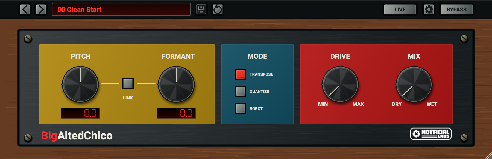
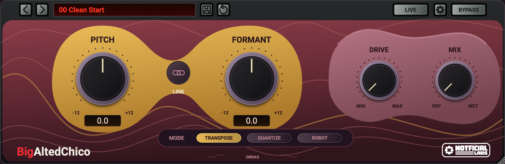
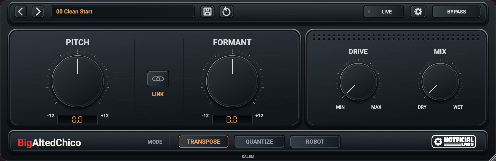

# Skins

Open the settings gear and choose **Skin → Juguete / Ondas / Salem**. Switching skins changes appearance without changing the audio parameters, LIVE mode or latency. The selected skin is saved with the DAW project and retained by the Standalone between launches. Sound presets do not replace it.

| Juguete | Ondas | Salem |
| --- | --- | --- |
|  |  |  |

All skins support 75%, 100% and 125% UI size. New instances use Clean: Pitch/Formant 0, Drive/Mix minimum. Existing DAW projects restore their saved sound.

The Skin menu can export a template, import a skin manifest, open the installed skins folder, and reload edited packs. A pack is a schema-1 JSON manifest plus self-contained SVG files. Start with the [Quickstart](../SkinTemplate/QUICKSTART.md), then read the [creator guide](../SkinTemplate/README.md) and [control/artwork reference](../SkinTemplate/CONTROL_REFERENCE.md). The kit includes a `recolour-example.json`, a minimal `salem-example.json`, and editable maps for the main interface and modal. CMake embeds a generated ZIP of this source folder.

On macOS, installed custom skins are in `~/Library/Notficial LABS/BigAltedChico/Skins/`. Use **Open skins folder** to find the actual location on the current platform. Projects store the skin ID, not its files: install the same pack on another computer. A missing pack falls back to Juguete and retains the requested ID so it can be restored later. Duplicate-ID imports are rejected to avoid overwriting custom work.

The built-in IDs `juguete`, `ondas`, and `salem` are reserved. Skins cannot add DSP controls, execute scripts, or load external resources. Unsupported/invalid packs produce an error. See the template for sizes, component IDs, logo slots and validation limits.
